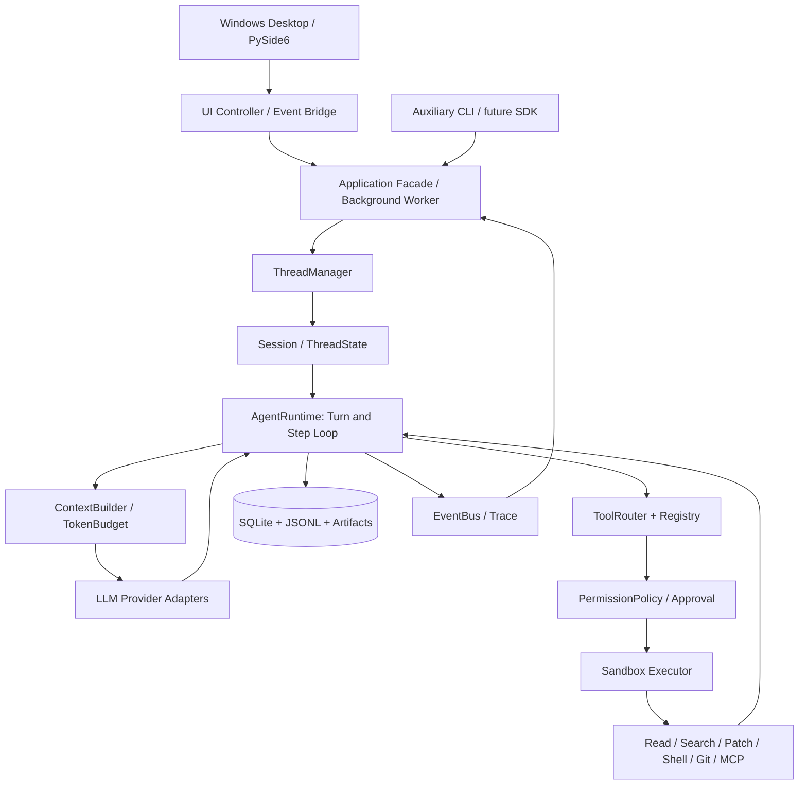

# MiniCodex：Windows 桌面客户端与 Python Coding Agent 开发计划书

> **版本**：v1.1 · **制定日期**：2026-10-13 · **修订日期**：2026-10-15  
> **定位**：优先交付原生 Windows 桌面编程助手，以 Python 实现可运行、可扩展、可评测的 Agent Harness / Runtime。  
> **参考基线**：[OpenAI Codex 官方开源仓库](https://github.com/openai/codex)，重点是 `codex-rs/core/`。  
> **交付形式**：Windows 桌面客户端（可执行程序与安装包）+ Python Agent 引擎 + 辅助 CLI + 文档 + 自动化测试 + Benchmark；API Server / SDK 后续扩展。  
> **原则**：优先复现 **可观察的功能和架构语义**，而非逐行翻译 Rust；源码以实施时固定的 Git commit 为准。

---

> **实施进度（2026-10-14）**：M0/M1 开发与本地验证完成，用户确认真实模型读文件分析通过。M2 Windows 原生执行线已实现，详情见 [M2 验收记录](m2-status.md)。用户确认没有 Docker、先完成原生执行，容器实机验收暂缓；GitHub CI 和干净系统验收尚未执行。

> **桌面体验更新（v0.3.1）**：已实现左侧独立命名/重命名的对话列表，中央用户/AI 图案、按步骤分组的输出与工具状态、操作审批，以及每轮用时和去重的编辑文件统计。切换会话保留展示记录；当前仍为内存会话，跨进程持久化属于 M3。

> **M3 更新（v0.4.0，2026-10-15）**：SQLite 会话持久化和重启恢复、未知结果处理、估算 Token 预算、结构化压缩、长结果归档回读、AGENTS.md 及 GUI 记录导出已实现，见 [M3 验收](m3-status.md)。密钥/模型设置保存仍属于后续 Task-023；Docker 按用户要求暂缓。

> **M4 更新（v0.5.0，2026-10-15）**：普通配置持久化、可选 Windows 凭据管理、配置迁移、最近项目、快捷键、DPI 布局、工具链提示及当前用户安装/卸载已实现，见 [M4 验收](m4-status.md)。本机隔离安装与程序包验证不代替干净 Windows VM 验收；Docker 继续暂缓。

## 0. 项目摘要与边界

**一句话目标**：用户在 Windows 打开 MiniCodex 桌面客户端，选择本地代码仓库并输入“修复 bug 并运行测试”，Agent 能自主探索仓库、选择工具、生成和应用补丁、运行受控测试、根据失败信息继续修复；客户端显示流式回答、工具进度、文件 diff、审批请求和测试证据，多轮任务可恢复、可中断、可追踪。

### 0.1 最终体验（目标，不代表现在已实现）

```text
双击 MiniCodex.exe
  → 选择本地项目文件夹
  → 新建会话 / 打开历史会话
  → 输入任务，查看流式回答与工具进度
  → 查看修改 diff，批准或拒绝具体操作
  → 在受控执行环境运行测试，查看退出码与日志
  → 停止任务 / 继续会话 / 导出任务记录
```

桌面布局：左侧为项目与会话列表，中间为聊天与任务进度，右侧为文件预览、diff 和测试结果；设置页管理模型、执行模式与预算。

辅助 CLI 用于开发调试、自动化测试和 Benchmark，不作为首版主要用户入口。V1 不要求用户安装 Python，也不要求 Linux 服务器；读/搜/改能力原生运行于 Windows。隔离命令执行可依赖 Docker Desktop 的 Linux 容器后端，具体依赖在客户端中检测并说明。

目标工作流：

```text
Windows 客户端：选择项目并输入“修复 Scheduler 的一个 bug，并执行单元测试”
    ↓
UI Controller → Application Facade（后台 Worker）
    ↓
Thread Manager → 开始 Turn
    ↓
Prompt / Context Builder → LLM Provider
    ↓
模型返回 Tool Calls（搜索代码 / 读取文件 / 修改补丁 / 执行测试）
    ↓
Tool Router → Permission Check → Sandbox Executor → Tool Result
    ↓
记录完整 observation、diff、metrics → 下一次 Step
    ↓
事件流更新界面：最终回答 + 文件 diff + 审批状态 + 测试证明 + Trace
```

### 0.2 三个不同层次的“复现”

1. **功能复现**：能通过 Windows 桌面界面完成常见的仓库编程任务（核心目标）。
2. **架构复现**：保持 Thread / Session / Turn / Step、工具路由、执行策略、上下文管理、事件流等职责分离（核心目标）。
3. **底层实现复现**：Rust 异步基础设施、操作系统原生沙箱、OpenAI 内部服务、专有认证与云端任务等（**不保证 1:1**；根据情况使用 Python 和现成系统组件替代）。

**明确不宣称**：MiniCodex 与官方 Codex 性能、正确率、安全隔离强度或全部产品功能等价。模型本身的推理能力也不属于本项目源码复现范围。

**开发与首发主平台**：Windows 11 x64，Python 3.12+，桌面 UI 暂定 PySide6 / Qt Widgets。核心引擎保持平台接口分离；Linux / WSL2 可用于容器执行和后续兼容测试，macOS、Windows ARM64 后续单独验收。

**执行模式**：默认对不受信任的命令使用受限容器；容器不可用时保留读/搜/改能力并禁用该类命令。可信项目的原生 Windows 测试执行作为显式开启、逐次审批的模式，必须标注“无 OS 沙箱隔离”，不得伪装成安全沙箱。原生模式与容器模式的测试结果分别记录，Linux 容器通过不代表 Windows 测试通过。

**本次范围调整**：桌面客户端是主交付物；GUI 从 M0 开始；CLI/TUI 降为辅助；Windows 兼容、任务停止、设置、会话记录与打包进入主线。远程 Linux 后端不属于首版前置条件。

---

## 1. 官方 Codex → MiniCodex 功能对照

> P0 必需；P1 实用性；P2 接近成熟 Codex；P3 高级实验。所有状态均为**计划中**，不是已实现。

| 优先级 | 官方 Codex 功能 / 设计 | MiniCodex 实现方案 | 验收重点 |
|---|---|---|---|
| P0 | Windows 桌面入口 | PySide6 主窗口、项目选择、聊天、设置 | 能从桌面启动，选择工作区并提交任务 |
| P0 | GUI 与后台运行解耦 | UI Controller + Application Facade + Worker | 模型/工具运行期间界面可响应，支持停止 |
| P0 | Windows 适配 | 路径校验、编码处理、进程管理 | 中文/空格路径、CRLF、盘符与取消行为正确 |
| P0 | Thread 与连续对话 | `ThreadManager` / `ThreadState` | 不同 Turn 共享历史、thread_id 稳定 |
| P0 | Turn / Step Agent Loop | `AgentRuntime` | 工具调用后自动继续，最终回答正确终止 |
| P0 | Model Client / Streaming | `LLMProvider` 接口、OpenAI-compatible Adapter | Tool calls、多次调用、流式/非流式 |
| P0 | Tool Registry / Router | `ToolRegistry`、`ToolDispatcher` | Schema、参数校验、错误回执 |
| P0 | 代码仓库探索 | `list_files`、`search_code`、`read_file` | 大仓库不会无脑加载所有文件 |
| P0 | 文件修改 | `apply_patch`、`git_diff` | 只修改允许文件，冲突时失败而非覆盖 |
| P0 | Shell / 测试执行 | `run_command`、进程/超时管理 | pytest/构建，捕获 exit_code/stdout/stderr |
| P0 | 执行安全与审批界面 | `ApprovalPolicy`、Executor Adapter、审批面板 | 隔离模式不可用时拒绝不可信命令；原生模式明确标注并逐次审批 |
| P0 | 事件/可追踪性 | typed events + JSONL trace | 可回放每个模型调用与工具结果（敏感信息脱敏） |
| P1 | 会话保存与恢复 | SQLite metadata + JSONL event log | 进程退出后恢复、未完成工具调用可识别 |
| P1 | Context Manager | Token 预算、摘要压缩、工具输出截断 | 长任务持续执行不超预算 |
| P1 | AGENTS.md | 层级指令发现与注入 | 正确处理仓库级/子目录指令 |
| P1 | Plan / Review | 计划工具、diff review 模式 | 显示计划与代码审查问题 |
| P0 | 停止任务 | 取消句柄、Windows 进程树清理、停止按钮 | 停止后不启动后续工具，不残留子进程 |
| P1 | 用户中途补充指令 | Async event queue、steer | 输入有明确关联，不丢失、不污染其他 Turn |
| P1 | Git 辅助 | 状态、diff、patch 校验、临时 worktree | 不破坏已有未提交改动 |
| P1 | 桌面分发与用户体验 | Windows 安装包、DPI、快捷键、错误提示 | 干净 Windows 环境可安装启动，无需系统 Python |
| P1 | 辅助 CLI | `Typer` + `Rich` | exec、resume、trace、自动化；TUI 后续按需 |
| P2 | MCP | Python MCP Client（stdio / Streamable HTTP） | 动态发现、调用、断线报错 |
| P2 | Skills | SKILL.md metadata、按需读取 | 不默认全量注入大型 Skill 文本 |
| P2 | 图像输入 | Provider 支持时发送图像内容 | 图片 + 文字混合消息与 graceful fallback |
| P2 | 动态工具发现 | 工具过滤 / lazy exposure | 大工具集情况下控制 Schema token |
| P2 | 多 Agent | 子 Agent / `spawn`, `wait`, `send` | 权限、上下文、预算隔离 |
| P2 | 执行并发 | 有条件的并行只读工具调用 | 写操作避免竞态，结果正确关联 call_id |
| P2 | App Server | FastAPI/WebSocket 或 stdio JSON-RPC 风格 API | UI/SDK 可以独立接入 |
| P2 | Python SDK | `MiniCodexClient` / `Thread` API | 在脚本中启动、继续、监听事件 |
| P2 | Bench / 可观测 | Replay、trace、metrics、任务基准 | 回归报告可重复、成本可统计 |
| P3 | Prompt caching 适配 | 利用 Provider 支持的缓存机制 | 不影响正确性，降低重复成本 |
| P3 | 后台持续任务 | 任务队列、隔离 worker、恢复 | 断线仍受控、状态可查询 |
| P3 | 多工作区/远程执行 | Worktree、远程执行器 Adapter | 严格权限隔离与一致性 |
| P3 | 插件/扩展/Hooks | hook 生命周期和扩展接口 | 可扩展但不破坏控制面安全 |
| 暂不做 | OpenAI 内部认证、云服务、私有模型训练、原生多平台沙箱实现 | 使用公开替代或显式标记不支持 | 不宣称完整 1:1 |

### 功能优先级判断

**第一道交付线：P0**。交付具有聊天、项目选择、进度、审批、diff、停止功能的 Windows 桌面原型，完成读/搜/改/测闭环；命令执行必须符合所选执行模式的权限要求。  
**第二道交付线：P0 + P1**。交付可安装的 Windows V1.0，包含会话恢复、上下文管理和真实任务评测，是小规模公开测试的最低目标。  
**第三道交付线：P2**。开始接近成熟 Codex Harness 的模块化能力。  
**P3** 按兴趣研究，不能阻碍前面版本稳定。

---

## 2. 总体软件架构

### 2.1 分层设计



- **应用层**只负责 UI 和应用接口，不直接决定工具策略；Qt 主线程只操作界面，独立 Worker 中运行 asyncio Agent 引擎，通过类型化命令和事件通信。审批等待使用异步 Future，不阻塞 UI；UI 不直接调用 shell。
- **Runtime** 决定何时请求模型、何时执行工具、何时终止。
- **Provider** 封装模型 API，不包含业务工具逻辑。
- **ToolRouter** 根据标准调用分派工具，**权限检查在实际执行前强制发生**。
- **Executor** 控制进程、工作区与资源边界；模型生成内容不享有可信代码的权限。
- **Storage** 保存对话、日志、执行结果与恢复检查点。

### 2.2 核心对象与生命周期

```text
Thread(id, persistent history, settings)
  └── Session(runtime owner, event queues, services)
        ├── Turn #1 (one task; may receive mid-turn input)
        │     ├── Step #1 (model request; may generate multiple tool calls)
        │     ├── Step #2 (after tool observations)
        │     └── Step #3 (final answer)
        └── Turn #2 (continues prior thread history)
              └── ...
```

**概念契约**：

| 对象 | 生命周期 | 负责内容 | 不负责内容 |
|---|---|---|---|
| `ThreadState` | 跨多个 Turn，可持久化 | 历史、线程 ID、配置、元信息 | 直接执行工具 |
| `Session` | 当前打开的运行会话 | 锁、事件队列、运行服务引用 | 构造所有工具实现 |
| `TurnState` | 一个任务期间 | `turn_id`、状态、开始/结束原因 | 长期跨 Thread 共享状态 |
| `StepContext` | 一次模型请求 | model 参数、工具快照、预算、取消句柄 | 永久历史归档 |
| `ToolCall` | 单次工具请求 | `call_id`、name、args | 决定是否值得再调用模型 |

**注意**：模型一次 Step 可以返回多个 tool calls；一个 Turn 可以包含很多 Step，不能把“一个用户问题 = 一次 LLM 请求”。

### 2.3 Runtime 状态机

```text
Thread: CREATED → IDLE ↔ RUNNING → CLOSED
                       │
                       └─ Turn: PENDING → RUNNING → {COMPLETED, FAILED, CANCELLED, LIMIT_EXCEEDED}

Step: BUILD_CONTEXT → MODEL_REQUEST → {FINAL_MESSAGE | TOOL_CALLS}
                                           │
                             VALIDATE → APPROVAL → EXECUTE → OBSERVE
                                           │
                                      NEXT_STEP
```

**错误终止要有明确状态**，不可在工具失败、达到调用上限或模型输出为空时笼统声明 `completed`。

---

## 3. 推荐工程目录（按领域模块组织）

以下目录保留为最初规划，包含尚未实现的模块。当前实现已整理为 `minicodex/backend/` 与 `minicodex/frontend/`，以 [项目架构](architecture.md) 为准。

```text
minicodex/
├── pyproject.toml
├── README.md
├── .env.example
├── configs/
│   └── default.yaml
├── minicodex/
│   ├── __init__.py
│   ├── desktop.py                     # Windows GUI 入口
│   ├── application/
│   │   ├── facade.py                  # start/cancel/approve/resume
│   │   ├── worker.py                  # 后台 asyncio Worker
│   │   └── commands.py                # UI 命令与请求关联
│   ├── cli.py                         # 辅助 Typer 命令入口
│   ├── api/
│   │   ├── server.py                  # FastAPI，可选
│   │   ├── routes.py
│   │   └── schemas.py
│   ├── core/
│   │   ├── models.py                  # Thread / Turn / Step / ToolCall 数据模型
│   │   ├── thread_manager.py
│   │   ├── session.py
│   │   ├── runtime.py                  # Agent Loop，最优先
│   │   ├── events.py                   # typed event 定义
│   │   ├── event_bus.py                # bounded asyncio.Queue
│   │   ├── lifecycle.py
│   │   └── errors.py
│   ├── llm/
│   │   ├── base.py                     # LLMProvider Protocol
│   │   ├── openai_compatible.py        # 第一个 Adapter
│   │   ├── messages.py                 # role/tool calls 映射
│   │   └── retry.py
│   ├── tools/
│   │   ├── base.py                     # ToolSpec, ToolResult, Tool Protocol
│   │   ├── registry.py
│   │   ├── router.py
│   │   ├── file_read.py
│   │   ├── file_search.py
│   │   ├── apply_patch.py
│   │   ├── shell.py
│   │   ├── git_tools.py
│   │   ├── plan.py
│   │   └── mcp_adapter.py
│   ├── execution/
│   │   ├── approval.py                 # deny / ask / allow
│   │   ├── policy.py                   # path/command/network rules
│   │   ├── executor.py                 # Executor Protocol
│   │   ├── windows_executor.py        # 显式开启的可信项目原生执行
│   │   ├── windows_paths.py           # 盘符、reparse point、路径边界
│   │   ├── docker_executor.py
│   │   ├── workspace.py
│   │   └── process_manager.py
│   ├── context/
│   │   ├── builder.py
│   │   ├── token_budget.py
│   │   ├── compactor.py
│   │   ├── tool_output.py
│   │   └── instructions.py             # AGENTS.md
│   ├── persistence/
│   │   ├── sqlite_store.py
│   │   ├── event_log.py
│   │   └── checkpoints.py
│   ├── extensions/
│   │   ├── mcp_client.py
│   │   ├── skill_loader.py
│   │   ├── hooks.py
│   │   └── subagents.py
│   ├── ui/
│   │   ├── main_window.py             # 工作区、会话、聊天布局
│   │   ├── controller.py              # 请求派发与事件关联
│   │   ├── event_bridge.py            # Qt 信号、背压与批量显示
│   │   ├── chat_panel.py
│   │   ├── diff_panel.py
│   │   ├── approval_panel.py
│   │   └── settings_dialog.py
│   └── observability/
│       ├── trace.py
│       └── metrics.py
├── packaging/
│   ├── windows/                       # 图标、安装脚本、部署配置
│   └── build_windows.ps1
├── tests/
│   ├── unit/
│   ├── integration/
│   ├── gui/                           # pytest-qt 界面与事件测试
│   ├── windows/                       # 路径、进程、编码与安装冒烟
│   ├── security/
│   └── e2e/
├── benchmarks/
│   ├── tasks/                     # 小型公开或自建可复现任务
│   ├── runner.py
│   └── report.py
└── docs/
    ├── architecture.md
    ├── protocol.md
    ├── security.md
    ├── decisions.md
    └── codex_source_map.md
```

**避免过度设计**：V0 允许把同一职责文件合并；先实现稳定接口，后续再拆。首版采用 PySide6 主线程 + 后台 Worker，通过 Application Facade 连接同一 Python 引擎，不要求先实现 HTTP 服务。后续远程后端再通过协议适配，不与当前 UI 控件耦合。

---

## 4. 核心接口与数据契约

### 4.1 建议的数据结构（示意，不是 Codex Rust 类型逐字转换）

```python
from dataclasses import dataclass, field
from enum import Enum
from typing import Any

class TurnStatus(str, Enum):
    PENDING = "pending"
    RUNNING = "running"
    COMPLETED = "completed"
    FAILED = "failed"
    CANCELLED = "cancelled"
    LIMIT_EXCEEDED = "limit_exceeded"

@dataclass(frozen=True)
class ToolCall:
    call_id: str
    name: str
    arguments: dict[str, Any]

@dataclass
class ToolResult:
    call_id: str
    success: bool
    content: str
    exit_code: int | None = None
    metadata: dict[str, Any] = field(default_factory=dict)

@dataclass
class TurnState:
    turn_id: str
    thread_id: str
    status: TurnStatus = TurnStatus.PENDING
    model_calls: int = 0
    tool_calls: int = 0
    error: str | None = None
```

### 4.2 接口必须可 Mock

```python
from typing import Protocol, AsyncIterator

class LLMProvider(Protocol):
    async def generate(self, messages: list[dict], tools: list[dict]): ...
    def stream(self, messages: list[dict], tools: list[dict]) -> AsyncIterator[object]: ...

class Tool(Protocol):
    name: str
    def schema(self) -> dict: ...
    async def execute(self, arguments: dict, context: object) -> ToolResult: ...

class Executor(Protocol):
    async def run(self, argv: list[str], *, cwd: str, timeout_s: float): ...

class ThreadStore(Protocol):
    async def load(self, thread_id: str): ...
    async def append_event(self, thread_id: str, event: dict): ...
```

建议 `Pydantic v2` 做边界参数校验，核心领域对象可使用 `dataclasses`。不要让 Router 直接依赖某一家模型的专有返回类型。

### 4.3 Agent Loop 的目标语义

```python
async def run_turn(thread, user_message, *, max_steps=20):
    messages = await store.load_valid_history(thread.id)
    messages.append({"role": "user", "content": user_message})
    for step in range(max_steps):
        await events.emit("step.started", step=step)
        llm_input = await context_builder.prepare(messages)
        response = await provider.generate(llm_input, registry.schemas())
        if response.tool_calls:
            # 关键：先保存包含 tool_calls 的 assistant 消息
            messages.append(response.as_assistant_message())
            for call in response.tool_calls:
                # 安全策略在真正执行前检查
                result = await router.execute_with_policy(call)
                # 对每个 call_id 都写一条对应的回执，包括拒绝/失败
                messages.append(result.as_tool_message())
                await events.emit("tool.finished", call_id=call.call_id)
            continue
        if response.final_text:
            messages.append({"role": "assistant", "content": response.final_text})
            await store.commit_valid_turn(thread.id, messages)
            return response.final_text
        raise EmptyModelResponse("未收到有效输出或工具调用")
    raise StepLimitExceeded("到达最大模型步骤数，任务未确认完成")
```

该伪代码仅描述**同步依次处理工具的基础版**。正式实现还需要：取消、流式输出、超时、审批暂停、消息持久化、模型调用/工具调用失败恢复、token 预算、并发回执排序。`StepContext` 在每次模型请求开始时冻结工具列表与权限视图，防止一次请求前后工具集合不一致。

---

## 5. 详细开发模块

### A. Agent Runtime：项目最核心的部分

**目标**：可证明正确的 Thread → Turn → Step 生命周期。

- `ThreadManager`: `create/list/get/resume/fork/archive/close`。
- `Session`: 管理一个 Thread 的状态、输入队列、事件流和运行锁。
- `TurnRunner`: `start/run/cancel/finish`，保证单 Thread 默认同一时刻只有一个写入型 Turn。
- `StepRunner`: 一次模型请求 + 响应解析 + 可能多个工具调用。
- `EventBus`: `thread.created`, `turn.started`, `step.started`, `model.delta`, `tool.started`, `tool.finished`, `approval.requested`, `turn.completed`, `turn.failed`。
- 支持用户打断；完成后不能再接受同 Turn 的写操作，避免 late tool result 污染状态。
- 全链路 `thread_id / turn_id / step_id / call_id`，每条事件都能追踪。

**验收**：mock Provider 按固定顺序返回读取→修改→测试→答案；运行两次 Turn 后历史顺序正确；取消/上限/空响应分别有确定终止状态。

### B. LLM Client：与 Agent 决策逻辑解耦

**目标**：OpenAI-compatible Function Calling 为第一优先。

- 支持 `messages`、`tools`、`tool_choice`、模型参数与解析。
- 兼容返回的 `tool_calls[]`，保存 `id/name/arguments`，不把 JSON 字符串视为可信参数。
- 流式模式将 delta 组装为完整调用后再执行；保留可见的流式文本输出。
- 超时、指数退避、429/5xx 重试、失败状态；**有副作用的工具不可因模型请求重试而重复执行**。
- 最先适配兼容 OpenAI Chat Completions 的服务；之后视模型需要加入 Responses API/Anthropic Adapter。
- 支持 OpenAI API、DeepSeek、Qwen 等兼容服务；本地 vLLM 可以作为 Provider，而不是硬耦合在 Agent 引擎中。

**验收**：使用录制响应或 Mock 模型覆盖普通文本、单工具、多工具、损坏 JSON、429、断流、stream reconnect。

### C. Coding Tools：能真正解决工程问题

第一批必须有：

1. `list_files(root, glob, max_results)`：排除 `.git`, `.venv`, `node_modules` 等。
2. `search_code(pattern, glob, max_results)`：优先 `ripgrep`，降级 Python 搜索；有输出大小限制。
3. `read_file(path, start_line, end_line)`：精确读取，不全量注入大文件。
4. `apply_patch(patch)`：统一 diff / 修改前内容校验；支持多文件，冲突时报错。
5. `run_command(argv, cwd, timeout_s)`：执行 pytest、lint、build；标准输出分流与限流。
6. `git_status()` / `git_diff()`：在修改前后反馈变更。

第二批：`write_file`（谨慎）、`open_image`（可选）、`update_plan`、`request_user_input`、`test_selection`。

**执行前置条件**：路径均要校验工作区边界和 symlink 逃逸；禁写 `.git` 元数据、敏感凭据等受保护路径；处理二进制、编码、大文件、patch 重入与并发写冲突；一律保留用户已有修改。

### D. Permission + Sandbox：Windows 执行边界

建议按 **deny / ask / allow** 三类决策实现，另加不可绕过的系统硬限制。

- 默认工具级策略：工作区内安全读取优先允许，写文件限制路径并按策略审批，不可信命令仅在受限容器内执行。可信项目原生执行必须由用户在设置中显式开启并逐次确认，属于有权限控制的宿主执行，不提供 OS 沙箱保证。
- `workspace-read`、`workspace-write`、`full-access` 是权限语义等级，**不能把配置选择本身当作有效的 OS 安全隔离**。
- 容器实现建议：非 root、只挂载允许工作区、禁挂 Docker socket、限制 CPU/内存/PID/执行时间、网络默认关闭、最小权限文件系统；镜像和依赖需固定版本。
- 没有可靠沙箱时默认拒绝不受信任的 shell 命令，不能悄悄回退成主机裸执行。
- `ApprovalRequest` 包含工具名、参数摘要、目标路径/命令、风险理由；审批对**本次动作**或严格限定的规则生效，不能由模型自行授权。
- 危险操作（删除、改大量文件、网络外传、读取敏感目录）采用权限控制，而不是靠提示词限制。
- Prompt Injection 防御：仓库 README、Issue 和工具返回内容均是**不可信数据**，不得直接提升为 system/developer 指令。
- 对取消、超时、重试保持 side-effect 语义：结果不明的工具调用不得自动无条件重放。
- Windows 原生执行采用明确的 executable + argv，禁止默认 `shell=True`；PowerShell 脚本必须显式选择解释器并审批完整脚本。路径、预算和命令检查不能保证 pytest/构建脚本无副作用，因此只用于用户明确信任的项目。
- 原生执行使用 Windows Job Object 等机制追踪和终止进程树；容器执行按容器 ID 停止并清理，不只结束 Docker 客户端。超时/取消后的清理必须有实际验收。
- 审批在 GUI 展示命令、cwd、目标路径、执行模式和修改摘要，并与 approval_id / call_id / turn_id 绑定。参数变化、任务取消或审批过期后不得沿用旧批准。

**验收**：恶意相对路径、绝对路径、symlink、删除命令、网络请求、超时、子进程残留、审批拒绝全部被正确处理；安全测试失败则阻断发布。

### E. Context Manager：长期运行的关键

- 保存**完整持久化会话**和**当前模型上下文窗口**两个不同视图。
- `TokenCounter`：模型 tokenizer 可用则精确估算，不可用则保守估算。
- 优先级：系统/开发指令、用户当前任务、最近步骤、必要工具结果、摘要化历史。
- `ObservationTruncator`：读取、搜索、测试的冗长输出限定大小，保留关键前后文及可回读路径。
- `Compactor`：上下文接近阈值时生成结构化摘要，包括目标、已做修改、失败原因、下步计划、未验证事项。
- 压缩后保留审计用原始完整历史，保证能够回看，而不是覆盖日志。
- 设计 `AGENTS.md` 发现与优先级规则；注意其内容来源属于工作区文件，需要信任模型区分。

**验收**：连续 20+ Step 的任务不发生上下文爆炸；工具输出大于 1MB 仍能通过截断运行；消息不会出现不完整 tool_call / tool 回执对。

### F. Persistence / Observability

- SQLite 存 Thread/Turn 元数据、状态、模型用量、任务索引；JSONL 存 append-only 执行事件；artifacts 存 diff/测试输出/可回读工具结果。
- 整体事件记录：`model.request`, `model.response`, `tool.request`, `approval`, `tool.result`, `context.compact`, `turn.end`。
- 每次调用关联 `call_id`，支持执行中断后显示“执行结果未知”而不是默认为失败。
- 明确密钥脱敏，日志默认不保存完整环境变量/认证头，原始 Prompt 日志需有 opt-in。
- GUI 任务记录面板查看执行流程并导出脱敏日志；辅助 CLI `trace show <thread_id>` 服务开发调试。benchmark 能按任务提取 token、时间、步数、失败原因。

### G. MCP、Skills、Multi-Agent（后续）

- MCP Client 支持 `tools/list`、`tools/call`，配置 `stdio` 和 HTTP；需要动态工具发现与类型映射、连接重启及超时。
- Skills：发现 `SKILL.md` 的 metadata，按需加载正文；支持仓库/用户级路径，不把所有 Skill 内容塞给模型。
- Multi-Agent：`spawn_agent`、`send_input`、`wait_agent`、`close_agent`；子 Agent 拥有独立历史与工具权限、继承受限预算。
- 写操作冲突防护：多个 Agent 不能无协调地并发改同一工作树；用 worktree 或写锁隔离。
- Hooks：`before_tool`、`after_tool`、`turn_start`、`turn_end`，拥有固定顺序、错误隔离与超时。
- 高级应用层：计划模式、代码审查模式、IDE/App Server、图像内容、动态工具检索。


### H. Windows 桌面客户端：首版主交付物

**技术路线（暂定）**：PySide6 / Qt Widgets + Python Agent 引擎；M0 固定已验证的依赖版本。采用 Python 技术栈降低首版跨语言维护成本。后续只有明确体验需求时再评估其他桌面技术。

- **项目与会话**：打开本地目录、最近项目、创建/切换/恢复会话；每个会话绑定工作区，运行中不能悄悄更换目标目录。
- **聊天与进度**：输入任务、流式回答、工具调用卡片、正在执行/等待审批/已停止/失败状态；可复制最终回答。
- **文件与修改**：分段预览文本，展示文件列表和统一 diff，标明已有修改；首版不做完整 IDE 或无条件“一键回滚”。
- **审批与执行**：展示具体动作和执行模式，批准/拒绝后交给 Runtime；测试日志显示命令、退出码、耗时以及运行平台。
- **停止与关闭**：停止按钮立即发出取消请求；停止完成须由后端确认。关闭窗口时对运行任务明确提示取消并等待清理，首版不支持关窗后偷偷继续工作。
- **设置**：模型、API 地址、预算、执行模式、依赖检测；原型阶段密钥可仅驻留内存，持久保存通过 Windows 凭据存储适配层实现，日志和配置导出脱敏。打包的运行时不代表目标仓库自带 Python/Git；执行前检测用户选择的工具链。
- **线程与事件**：Qt 主线程只渲染控件；Worker 管理独立 asyncio 循环。事件带 thread/turn/step/call ID 与序号，禁止跨会话混入；输出采用有界队列、分批刷新和日志回读，大日志不冻结窗口。
- **Windows 路径**：覆盖盘符、大小写、中文与空格、CRLF、长路径、文件占用、junction/symlink/reparse point 逃逸；首版默认仅支持本地磁盘工作区，UNC/网络盘拒绝并说明原因。路径规范化与执行前检查统一放在 Policy/Workspace 层。
- **本地数据**：配置、SQLite、JSONL 与 artifacts 存在当前用户的 LocalAppData/MiniCodex 下，不写入程序安装目录；数据库版本可迁移，卸载是否删除用户数据需明确选择。
- **分发**：先完成 Windows 可执行目录包，再生成带快捷方式与卸载入口的安装包；在无 Python 的干净 Windows 11 x64 环境验证。代码签名和自动更新另列后续项，不作为原型前置条件。

**验收**：打开带中文/空格路径的测试仓库，连续两轮对话能调用工具；运行期间可切换查看面板，拒绝审批不会执行动作，停止后无后续工具或残留进程，重启可查看历史和未知结果，安装包可正常卸载。

---

## 6. 开发阶段、里程碑与验收标准

> 单人兼职以 **14–18 周完成 Windows V1.0（P0 + 主要 P1）** 为初步估算；GUI、打包与 Windows 兼容增加工作量。按实际验收调整周期，P2/P3 不阻碍主线。所有阶段均为计划中。

| 阶段 | 周期建议 | 主要任务 | 交付结果 | 完成定义 (DoD) |
|---|---|---|---|---|
| M0 Windows 骨架与技术验证 | 第 1 周 | Python 包、PySide6 窗口、Facade/Worker、数据契约、Fake Provider、Windows CI、初次打包 | 可启动的桌面骨架 | UI 响应正常；可选择目录；干净 Windows 能启动验证包 |
| M1 桌面只读 Agent | 第 2–4 周 | Thread/Turn/Step、Provider、Registry、read/list/search、流式事件、停止、路径读取检查 | 能在桌面理解仓库的 V0.1 | 两轮对话；回执配对；模型请求可取消；中文路径可读；异常状态明确 |
| M2 修改与受控测试闭环 | 第 5–7 周 | patch/git/diff、审批界面、容器执行、原生可信模式、进程树清理、安全测试 | 能读→改→测→总结的 V0.2 | 10 个 Python bug 闭环；执行模式明确；审批拒绝不执行；相关安全门禁通过 |
| M3 会话与上下文可靠性 | 第 8–10 周 | SQLite/JSONL、恢复、预算、压缩、AGENTS.md、失败恢复、事件背压 | 可恢复的长任务客户端 | 20+ Step；未知结果可识别；不自动重放有副作用动作；大量日志不冻结 GUI |
| M4 客户端完善与分发 | 第 11–13 周 | 会话列表、设置/凭据、任务记录、DPI、快捷键、安装/卸载、依赖提示 | Windows 安装候选版 | 无 Python 的干净 Windows 可安装运行；目标项目工具链缺失有提示；密钥不泄露 |
| M5 回归与 Benchmark | 第 14–18 周 | GUI/Windows/E2E/安全回归、性能对照、用户文档、演示 | Windows V1.0 | 安装与任务验收通过；公开复现报告；边界和已知问题明确 |
| M6 MCP/Skills/多 Agent | V1.0 之后 | MCP、Skills、受控子 Agent、只读并发 | V1.5 增强版 | 标准服务可连接；权限/预算隔离；无并发写冲突 |
| M7 跨平台与服务化 | 后续 | Linux/macOS、App Server、SDK、远程执行、插件 | V2.0 研究版 | 跨平台分别验收；独立协议与真实性能报告 |

### M0 / M1 细分开发任务（最先执行）

- [x] `Task-001` 建立 `pyproject.toml`、pytest、ruff、mypy、pytest-qt 与 Windows CI；固定依赖版本。
- [x] `Task-002` 建立 ToolCall、ToolResult、TurnStatus 与 GUI 事件/命令数据契约。
- [x] `Task-003` 实现 FakeLLMProvider，固定返回工具调用序列。
- [x] `Task-004` 创建 PySide6 主窗口、项目选择、聊天输入、工具进度和停止按钮。
- [x] `Task-005` 建立 Application Facade、后台 asyncio Worker 与 Qt Event Bridge。
- [x] `Task-006` 实现 ToolRegistry、参数校验、ThreadStore 内存版与历史顺序检查。
- [x] `Task-007` 实现 AgentRuntime.run_turn、max_steps、取消与明确错误状态。
- [x] `Task-008` 实现 list_files/read_file/search_code 与 Windows 路径边界检查。
- [x] `Task-009` 接入 OpenAI-compatible Provider、流式回答及设置页最小配置。
- [x] `Task-010` GUI 连续两轮对话测试；中文/空格路径测试；早期可执行程序打包冒烟。

### M2 细分开发任务

- [x] `Task-011` apply_patch：原文校验、diff 预览、CRLF/编码保留、并发写检测。
- [x] `Task-012` git_status/git_diff 与 GUI diff 面板，保护用户已有修改。
- [x] `Task-013` 审批面板：参数摘要、执行模式、批准/拒绝/失效状态。
- [ ] `Task-014` Docker Executor 代码及模拟 CLI 测试已实现；用户确认先完成原生执行，实机验收待 Docker 环境。
- [x] `Task-015` 可信项目 Windows Executor：显式开启、逐次审批、argv/cwd/环境与日志控制。
- [ ] `Task-016` Windows 进程树取消/超时/正常退出清理已实测通过；容器清理实机验收随 Docker 暂缓。
- [x] `Task-017` Windows 写路径安全：junction/symlink、盘符、保护路径、文件占用与未知结果处理。
- [x] `Task-018` 失败反馈与预算限制；10 个脚本化模型决策 + 实际读改测任务通过，真实模型修复 Benchmark 待验收。
- [ ] `Task-019` Windows 原生路径/审批/执行/取消门禁通过并交付；Docker 相关实机门禁仍待验收。

### M3–M5 细分开发任务

- [x] `Task-020` SQLite/JSONL 保存、恢复、执行结果未知、工具回执完整性。
- [x] `Task-021` Token 保守估算预算、工具输出归档/截断/回读、结构化提取压缩、按目录 AGENTS.md。
- [x] `Task-022` GUI 事件排序、背压、会话切换、关闭窗口与恢复验证。
- [x] `Task-023` 设置与 Windows 凭据适配层、密钥脱敏、配置迁移。
- [ ] `Task-024` Windows 部署包/安装包、DPI、缺失依赖提示及本机隔离安装/覆盖重装/卸载已实现；干净 Windows 11 x64 与真实多屏验收待执行。
- [ ] `Task-025` GUI、Windows、E2E、安全回归与 Benchmark 报告。

### 后续 Epic（不要提前占用主线时间）

- `EPIC-MCP` MCP 客户端与动态工具管理。
- `EPIC-SKILL` Skills 加载及上下文注入。
- `EPIC-MULTI` 子 Agent 调度、权限与工作区隔离。
- `EPIC-SERVER` App Server / SDK / 远程后端 / IDE 集成。
- `EPIC-CROSS` Linux、macOS、ARM64 与网络盘支持。
- `EPIC-UPDATE` 代码签名、升级迁移与自动更新。
- `EPIC-PERF` Token、工具和客户端性能优化。

---

## 7. 测试方案与性能指标

### 7.1 核心、GUI 与 Windows 测试

1. **单元测试**：模型响应解析、状态机、tool schema、路径规则、历史配对、compaction。
2. **集成测试**：Mock Provider + 真实临时 Git 仓库 + 容器执行器。
3. **端到端任务**：带已知 bug 的样例仓库，自动修复并运行 tests。
4. **安全/故障测试**：Prompt Injection、恶意路径、被拒审批、断网、429、超时、中断及重入。
5. **GUI 测试**：pytest-qt + Fake Provider 验证提交任务、流式事件、工具卡片、审批、diff、停止、会话切换；验证慢模型与大日志下 UI 能响应。
6. **Windows 与分发测试**：中文/空格路径、盘符/大小写、CRLF、junction、文件锁、进程树清理、DPI；在无 Python 的干净 Windows 验证安装、启动、卸载及无 Docker 时的降级提示。

Windows CI 执行核心/GUI/原生路径与进程测试，Linux CI 在后续用于引擎可移植性。Docker 集成与安装包测试使用具备对应环境的独立任务；缺失依赖须显式标为 skipped，不能计作通过。原生 Windows 与 Linux 容器的结果必须标明 executor 和 OS。

建议建立固定的 `benchmarks/tasks`，每个任务都有：

```yaml
id: python-bug-001
repo: fixtures/example_repo
base_commit: "<fixed git sha>"
user_prompt: "修复 parse_config 在空字典输入时的异常"
test_command: ["python", "-m", "pytest", "-q"]
expected: "hidden tests pass"
max_steps: 20
budget_usd: 1.0
```

验收时不仅看 Agent 自己声称“已修复”，而要用**独立的测试命令/隐藏测试**判断。

### 7.2 指标与日志

| 指标 | 定义 | 目的 |
|---|---|---|
| `task_success_rate` | 独立验收任务通过比例 | 最核心正确性指标 |
| `model_calls/task` | 每任务模型请求次数 | 了解循环深度 |
| `tool_calls/task` | 每任务工具调用次数 | 是否出现无效工具往返 |
| `input/output_tokens` | 输入、输出 Token 分别统计 | 成本分析 |
| `wall_time_p50/p95` | 任务完成耗时 | 用户体验 |
| `tool_latency_p95` | 工具完成延迟 | 识别 I/O 瓶颈 |
| `patch_apply_failure_rate` | 补丁应用失败次数/尝试次数 | 文件修改质量 |
| `context_compaction_count` | 每任务压缩次数 | 上下文策略效果 |
| `approval_denied_count` | 被拒绝的工具调用次数 | 安全行为观察 |
| `recovery_success_rate` | 中断后可恢复任务比例 | 工程可靠性 |
| `ui_event_latency_p95` | 事件产生到界面显示的延迟 | 客户端响应性 |
| `cancel_cleanup_time` | 用户停止到进程/容器清理完成的耗时 | 停止行为可靠性 |
| `desktop_startup_time` | 启动至界面可交互的时间 | 分发体验 |

**性能优化必须采用 A/B 对照**：相同任务集、尽可能固定模型版本/采样参数/预算，记录延迟与 token；同时测成功率，防止“省了 token 但修复率下降”。

### 7.3 建议的质量门槛（项目目标，非既有成绩）

- M1：Mock Provider 核心循环测试 **100% 通过**；GUI 两轮对话通过；工具回执不丢失、不乱序；慢请求期间窗口可响应。
- M2：10–20 个简单 bug 闭环评测逐步追求 ≥70% 成功率；所有相关路径/审批/执行/取消门禁必须通过。该成功率目标不代表对任意真实仓库有同等表现。
- M3：恢复历史无悬空 tool_call；未知结果不自动重放；20+ Step 和大输出不导致 OOM 或 GUI 冻结。安全门禁持续运行，不能以任务成功率抵消安全失败。
- M4：在无 Python 的干净 Windows 11 x64 上安装、启动、配置模型、打开项目与卸载通过；日志/导出无密钥；无 Docker 时不默默执行不可信宿主命令。
- M5：全部必需 GUI/Windows/E2E/安全回归通过；至少对照无压缩 vs 压缩、检索策略 A vs B。安全并发若未实现则延后到 M6，不能提前报告成绩。
- 后续可研究 SWE-bench 类型的公开基准；先解决执行成本、许可、可复现环境和数据泄漏问题，再报告任何成绩。

---

## 8. 依赖、工程规范和成本控制

### 推荐技术栈

| 领域 | 推荐 | 备注 |
|---|---|---|
| 语言 | Python 3.12+、`asyncio` | 易于快速复现架构 |
| 数据校验 | Pydantic v2 | API/tool 参数边界 |
| 桌面界面 | PySide6 / Qt Widgets（暂定） | Windows GUI 主入口；Qt 主线程渲染，后台 Worker 运行引擎 |
| GUI 测试 | pytest-qt | Fake Provider 驱动，测试事件与用户交互 |
| Windows 分发 | pyside6-deploy 验证，必要时评估 PyInstaller；安装器在 M4 确定 | M0 做早期打包验证；发布依赖固定，附许可证材料 |
| CLI | Typer + Rich | 调试、自动化与 Benchmark，TUI 后续按需 |
| Windows 适配 | 路径/reparse point 校验、Job Object、凭据存储 Adapter | 不将原生执行权限控制宣称为 OS 沙箱 |
| 模型访问 | `httpx` / OpenAI SDK（Adapter 封装） | 不将 SDK 对象暴露到 core |
| 数据库 | SQLite + `aiosqlite` | 后期按需切 PostgreSQL |
| 文件与搜索 | `pathlib` + `ripgrep` | 输出严格限长 |
| 执行器 | Docker SDK / `asyncio.create_subprocess_exec` + Windows 进程管理 | 容器模式与显式批准的原生模式分开；subprocess 本身不是沙箱 |
| MCP | 官方 `mcp` Python SDK | 客户端与工具映射 |
| 测试与质量 | `pytest`, `pytest-asyncio`, `ruff`, `mypy` | Mock 大模型不可缺少 |
| 可观测 | JSONL trace + Prometheus/OpenTelemetry（后期） | 从最小可复现指标开始 |

桌面技术参考：[Qt for Python](https://doc.qt.io/qtforpython-6)；分发方案参考：[Qt 部署指南](https://doc.qt.io/qtforpython-6/deployment/index.html)与 [pyside6-deploy](https://doc.qt.io/qtforpython-6/deployment/deployment-pyside6-deploy.html)。具体版本、插件、体积、许可与安装方式在 M0/M4 验证后固定。

### 需要主动控制的成本

- 每个 Turn 配置 `max_steps`、`max_model_calls`、`max_tool_calls`、`max_input_tokens`、`max_runtime_s`、成本上限。
- 每次模型请求记录估计用量；模型服务未返回用量时单独标为 `estimated`。
- 工具读取必须分段，禁止把全仓库或全部测试日志一次性塞入 LLM。
- 并发不等于一定更快：对于写操作和模型串行依赖的步骤，优先正确性。
- Provider 可换成本地 vLLM，以便之后研究 Agent 多轮请求延迟；**首先用可靠 API 模型验证 Harness**，不要让小模型的决策能力掩盖框架问题。

---

## 9. 学习用源码映射（2026-10-13 核对 `main`）

| 你需要学什么 | Codex 官方位置 | MiniCodex 对应位置 |
|---|---|---|
| 对话入口、任务提交 | [`core/src/codex_thread.rs`](https://github.com/openai/codex/blob/main/codex-rs/core/src/codex_thread.rs) | `core/thread_manager.py` |
| Thread 资源管理 | [`core/src/thread_manager.rs`](https://github.com/openai/codex/blob/main/codex-rs/core/src/thread_manager.rs) | `core/thread_manager.py` |
| Session 容器 | [`core/src/session/session.rs`](https://github.com/openai/codex/blob/main/codex-rs/core/src/session/session.rs) | `core/session.py` |
| 任务启动 | [`core/src/tasks/regular.rs`](https://github.com/openai/codex/blob/main/codex-rs/core/src/tasks/regular.rs) | `core/runtime.py` |
| Turn 主循环 | [`core/src/session/turn.rs`](https://github.com/openai/codex/blob/main/codex-rs/core/src/session/turn.rs) | `core/runtime.py` |
| Step 快照 | [`core/src/session/step_context.rs`](https://github.com/openai/codex/blob/main/codex-rs/core/src/session/step_context.rs) | `core/models.py` |
| 模型客户端 | [`core/src/client.rs`](https://github.com/openai/codex/blob/main/codex-rs/core/src/client.rs) | `llm/openai_compatible.py` |
| 工具定义与选择 | [`core/src/tools/spec_plan.rs`](https://github.com/openai/codex/blob/main/codex-rs/core/src/tools/spec_plan.rs) | `tools/registry.py` |
| 工具路由 | [`core/src/tools/router.rs`](https://github.com/openai/codex/blob/main/codex-rs/core/src/tools/router.rs) | `tools/router.py` |
| 工具执行并发 | [`core/src/tools/parallel.rs`](https://github.com/openai/codex/blob/main/codex-rs/core/src/tools/parallel.rs) | `core/runtime.py` / `execution/` |
| 权限与执行重试 | [`core/src/tools/orchestrator.rs`](https://github.com/openai/codex/blob/main/codex-rs/core/src/tools/orchestrator.rs) | `execution/approval.py`、`executor.py` |
| 模型历史管理 | [`core/src/context_manager/history.rs`](https://github.com/openai/codex/blob/main/codex-rs/core/src/context_manager/history.rs) | `context/builder.py` |
| Patch 工具 | [`core/src/tools/handlers/apply_patch.rs`](https://github.com/openai/codex/blob/main/codex-rs/core/src/tools/handlers/apply_patch.rs) | `tools/apply_patch.py` |
| MCP 工具接入 | [`core/src/tools/handlers/mcp.rs`](https://github.com/openai/codex/blob/main/codex-rs/core/src/tools/handlers/mcp.rs) | `extensions/mcp_client.py` |
| 多 Agent | [`core/src/agent/`](https://github.com/openai/codex/tree/main/codex-rs/core/src/agent) | `extensions/subagents.py` |
| 外部交互协议 | [`codex-rs/protocol/`](https://github.com/openai/codex/tree/main/codex-rs/protocol) | `core/events.py` / `api/schemas.py` |
| App Server | [`codex-rs/app-server/`](https://github.com/openai/codex/tree/main/codex-rs/app-server) | `api/server.py` |
| 会话记录 | [`codex-rs/rollout/`](https://github.com/openai/codex/tree/main/codex-rs/rollout) | `persistence/event_log.py` |

**源码阅读顺序**：`tasks/regular.rs` → `session/turn.rs` → `tools/router.rs` → `tools/registry.rs` → `tools/orchestrator.rs` → `client.rs` → `context_manager/history.rs`。

建议在 `docs/codex_source_map.md` 记录每次阅读的 **commit SHA + 类/函数 + 自己的 Python 对应实现**，防止 Codex `main` 日常更新导致行号和实现不一致。

---

## 10. 第一周的可执行日程

- **Day 1**：创建 Python 包，设计 ThreadState/TurnState/ToolCall/ToolResult；确认 Windows 11 x64 与依赖版本，固定源码参考 commit。
- **Day 2**：搭建 PySide6 窗口，加入项目选择、聊天输入、消息列表、工具状态和停止按钮。
- **Day 3**：建立 Application Facade、后台 Worker 与事件桥；用 FakeLLMProvider 验证后台运行期间 UI 响应。
- **Day 4**：实现 ToolRegistry/Router、list_files/read_file 及 Windows 读取路径检查。
- **Day 5**：实现最小 Agent Loop、call_id 配对、两轮历史、max_steps 与取消；GUI 展示真实工具结果。
- **Day 6**：跑核心和 GUI 测试，覆盖中文/空格路径；有余量再接真实 API，仅做只读代码理解任务。
- **Day 7**：首次打包验证桌面程序，整理 README、架构图、测试记录与下一阶段任务；未完成闭环项转入 M1，不以七天代替验收。

**第一周目标**：在 Windows 打开桌面窗口，选择仓库并输入“这个仓库有哪些文件？”，通过 Fake Provider 调用真实 list_files 工具并显示结果；第二个问题延续第一轮历史。此阶段不开放宿主 shell 或无限制写权限，完整流式模型接入、只读安全门禁与停止验收在 M1 收敛。

---

## 11. 可直接用于 GitHub 的项目介绍（草案）

> **MiniCodex** is a Windows-first desktop coding assistant powered by a Python-based agent harness inspired by the open-source architecture of OpenAI Codex. It provides thread/turn/step lifecycle management, model tool-calling loops, repository exploration, patch-based edits, sandboxed command execution, context management, and resumable sessions. Advanced modules include MCP tool integration, Skills, multi-agent coordination, tracing, and automated coding benchmarks.
>
> 本项目优先交付 Windows 桌面客户端，提供项目选择、聊天、工具进度、diff、审批和测试结果界面，以清晰、可测试、可扩展的 Python 引擎实现 Coding Agent 的关键运行机制，并通过真实软件修复任务评估工具调用效率、Token 开销、执行安全与任务成功率；**不是 OpenAI 官方 Codex 的移植或等价替代品**。

---

## 12. 重要工程决策（ADR 初稿）

- **ADR-001：使用 Python + asyncio**。优先架构清晰与迭代速度，性能瓶颈再单独优化。
- **ADR-002：工具执行必须经过 Policy**。不允许 LLM 直接决定绕开沙箱。
- **ADR-003：以 FakeLLMProvider 驱动大部分测试**。减少成本并使失败可复现。
- **ADR-004：会话数据与模型窗口分开**。完整事件可回看；模型只拿当前所需上下文。
- **ADR-005：按 `call_id` 关联工具回执**。避免并行工具错配以及恢复后历史损坏。
- **ADR-006：首次发布优先 Windows 11 x64 桌面客户端**。Python 3.12+ 引擎原生运行，Linux/macOS/ARM64 后续分别验收；CLI 为辅助入口。
- **ADR-007：安全边界由执行器强制实施**。Prompt 不能替代 OS/容器权限。
- **ADR-008：所有创新都配回归评测**。特别是上下文优化、工具并行和规划策略。
- **ADR-009：桌面 UI 暂定 PySide6 / Qt Widgets**。M0 验证 UI、线程通信与打包，避免首版同时维护多套界面框架。
- **ADR-010：UI 与引擎通过 Facade 和事件桥分离**。Qt 主线程渲染，后台 asyncio Worker 执行；API Server 后续按需。
- **ADR-011：隔离执行与可信原生执行分开**。默认不可信命令要求容器；原生执行显式开启、逐次审批、标注无 OS 沙箱。环境缺失不得静默降级。
- **ADR-012：Windows 分发属于主交付线**。在干净系统验证，目标项目工具链单独检测；附依赖许可证材料，不强制以管理员身份启动。

## 13. 最终交付清单

- [ ] GitHub 仓库，MIT/Apache-2.0 或经法务/许可证检查后选定许可（不复制不兼容代码）。
- [ ] Windows 桌面可执行程序与安装包，在无系统 Python 的 Windows 11 x64 可安装、启动与卸载。
- [ ] 项目/会话列表、聊天与流式回答、工具进度、文件 diff、审批、停止、设置与任务记录。
- [ ] `pip install -e .` 后开发者可启动 GUI；辅助 CLI 支持 exec、resume、review、trace。
- [ ] 完整 Agent Loop：Tool Calling、执行、反馈、直到终止。
- [ ] 读/搜/改/测代码工具集，安全执行器和审批策略。
- [ ] 多轮 Thread 持久化、Context 压缩、AGENTS.md。
- [ ] Windows 路径/编码/进程清理、执行模式提示、工具链检测、凭据保护、GUI 与安装包验收。
- [ ] 可选 MCP、Skills、Multi-Agent、API Server（V1.0 后续）。
- [ ] pytest 单测、pytest-qt GUI 测试、Windows 集成测试、E2E 修复任务、安全测试与安装冒烟。
- [ ] Benchmark 报告：成功率、总时延、模型调用次数、Token 使用、失败分析。
- [ ] 演示录像/GIF、架构图、关键源码分析和设计取舍说明。

---

## 附：官方资料

1. [OpenAI Codex 官方仓库](https://github.com/openai/codex)
2. [codex-core README](https://github.com/openai/codex/blob/main/codex-rs/core/README.md)
3. [Codex App Server](https://github.com/openai/codex/tree/main/codex-rs/app-server)
4. [Codex Security / Sandbox 官方文档](https://developers.openai.com/codex/security)
5. [Codex Skills 官方文档](https://developers.openai.com/codex/skills)
6. [Codex AGENTS.md 指南](https://developers.openai.com/codex/guides/agents-md)
7. [Model Context Protocol 官方站点](https://modelcontextprotocol.io/)

> **最重要的一句话**：先交付一个能在 Windows 打开、选择项目、对话、显示进度与 diff、审批和停止任务的 **桌面客户端 + Python Agent Loop + Read/Search/Patch/Test**；执行边界与核心测试同步实现，再扩展 MCP、Skills、多 Agent 和服务化。
